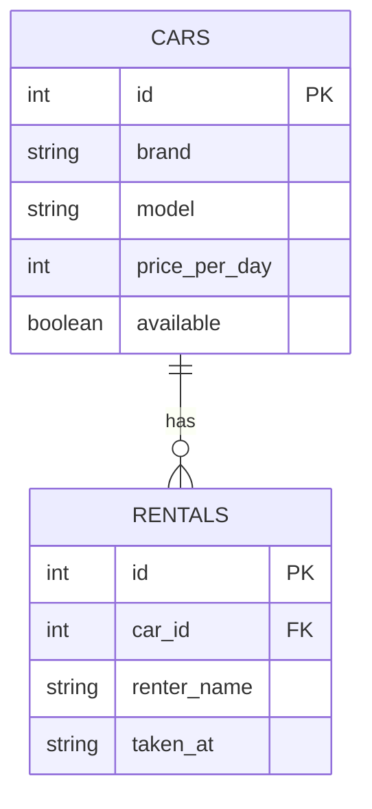

# Прокат автомобилей

## Запуск

pip install -r requirements.txt
flask db upgrade
python seed.py
python app.py

Сервис слушает http://localhost:8000

## Эндпоинты

| Метод | Путь | Описание |
| --- | --- | --- |
| GET | /health | проверка живости |
| POST | /api/cars | создать автомобиль |
| GET | /api/cars | список (limit, offset, brand, q) |
| GET | /api/cars/{id} | один автомобиль |
| PATCH | /api/cars/{id} | обновить |
| DELETE | /api/cars/{id} | удалить |
| POST | /api/cars/{id}/rentals | создать аренду |
| GET | /api/cars/{id}/rentals | список аренд |
| GET | /api/cars/stats | статистика |

## ER-диаграмма



## Индекс и EXPLAIN

На поле `cars.brand` создан индекс (`index=True` в модели `models.py`).

Проверка использования индекса:

```sql
EXPLAIN SELECT * FROM cars WHERE brand = 'Toyota';
```

```
SEARCH cars USING INDEX ix_cars_brand (brand=?)
```
